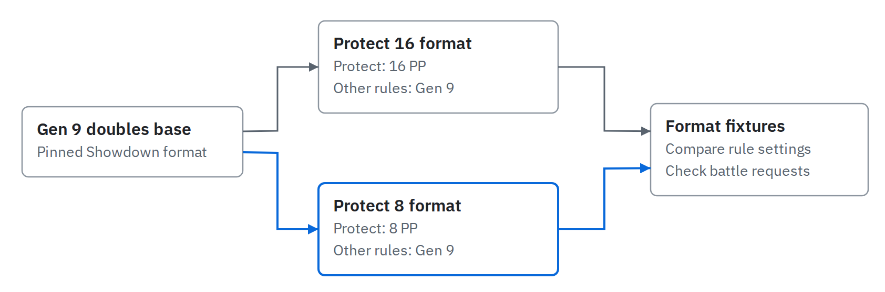
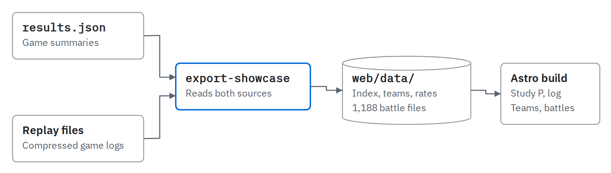

# VGC Rulebreak

[](https://github.com/Builder106/vgc-rulebreak/actions/workflows/ci.yml)
[](https://www.python.org/downloads/)
[](#license)

VGC Rulebreak uses Pokémon Showdown to study how competitive agents handle rule changes. The first question: does cutting Protect from 16 PP to 8 make an agent's old habits costly?

The first batch of games couldn't answer that question. It compared standard Gen 9 with the full Champions mod, which changes more than Protect. The code now has a pair of experimental formats whose overlay changes only Protect PP, but those games have not been rerun. The [research plan](RESEARCH.md) also covers Rage Fist, Speed, full Champions transfer, and Tera/Mega transfer.

## Project status

The recorded study has 99 checkpoints and 1,188 held-out games. No agent ran out of Protect PP. Since the formats also differed in other mechanics, these games cannot tell us what the PP change alone did. The [study audit](docs/protect-pp-audit.md) explains the problem and what needs to happen before another outcome claim.

You can explore every recorded game and the open team sheets in the [live showcase](https://vgc-rulebreak.vercel.app). The [roadmap](ROADMAP.md), [showcase brief](docs/showcase.md), and [site design notes](web/DESIGN.md) cover the rest of the work.

## The corrected Protect formats

Both experimental formats copy the same pinned Gen 9 Doubles Custom Game rules. One leaves Protect at 16 PP; the other sets its starting and maximum PP to 8, including the move slot restored after a switch. Live simulator tests check the key format settings and battle requests. Broader paired checks and a scarcity pilot are still needed before measuring the effect on outcomes.

<picture>
  <source media="(prefers-color-scheme: dark)" srcset="assets/diagrams/protect-formats-dark.png">
  
</picture>

These are experimental formats, not official regulations. The existing 1,188 games still belong to the earlier Gen 9 versus full Champions comparison. [Edit this diagram](assets/diagrams/protect-formats.html).

## Run the study tools

Use Python 3.12 and uv 0.12.5:

```sh
uv sync --frozen --group dev
uv run vgc-rulebreak check experiments/protect-pp.json
```

This checks the declared PP variants, pinned simulator revision, and independent training seeds. It does not inspect the simulator's effective formats; the live tests in `tests/test_protect_formats.py` do that.

Run deterministic mechanics verification against a local Pokémon Showdown process:

```sh
uv run vgc-rulebreak verify-mechanics --spec experiments/protect-pp.json
```

This checks Protect's 16 versus 8 maximum PP, Rage Fist's hit counter after switching, and the Speed formulas.

To try the comparison harness with its hand-written source, adapted, and native agents, keep every game:

```sh
uv run vgc-rulebreak compare-agents --quick --output-dir runs/compare-quick
```

This writes `results.json` and a gzipped replay for each game to `runs/compare-quick/`. These agents use hand-written Protect scoring rules, so this run checks the harness. It does not measure learned adaptation.

```sh
uv run vgc-rulebreak check experiments/protect-pp.json --require-ready
```

This exits with code 1 while the study spec still has missing declarations. [CONTRIBUTING.md](CONTRIBUTING.md) lists the checks and exit codes.

## Run the showcase

The site lives in `web/`. To check and build it locally:

```sh
cd web
npm ci
npm run check
npm run lint
npm run build
npx playwright install chromium
npm run test:browser
```

The committed `web/data/` export contains all 1,188 battle records. To rebuild it from evaluation runs, point `vgc-rulebreak export-showcase --runs` at the run directory and set `--output web/data`. The export gets move names from the pinned Showdown checkout. For a public build, set `SITE_URL` to its origin so Astro can write canonical URLs and the sitemap.

## Where the showcase data comes from

Each evaluation run writes a `results.json` index and a compressed replay for each recorded game. `export-showcase` reads both, writes the compact `web/data/` export, and Astro uses that export to build the study, log, team, and battle pages.

<picture>
  <source media="(prefers-color-scheme: dark)" srcset="assets/diagrams/showcase-data-dark.png">
  
</picture>

The current export comes from the earlier comparison. Its format IDs and replays retain that provenance; the site does not turn those games into a Protect-only experiment. [Edit this diagram](assets/diagrams/showcase-data.html).

## Repository layout

| Path | Contents |
| --- | --- |
| `src/vgc_rulebreak/` | Specification validation, simulator adapter, fixtures, and CLI |
| `experiments/` | Versioned study specifications |
| `tests/` | Control-validation and CLI checks |
| `web/` | Static showcase, exported games, and browser checks |
| `RESEARCH.md` | Questions, controls, evaluation, and sources |
| `ROADMAP.md` | Implementation milestones and exit criteria |
| `docs/showcase.md` | Blunder Replay, Habit Recovery, and Matchup Desk brief |
| `JOURNAL.md` | Decisions behind the project |

Training data, checkpoints, raw replays, and generated reports stay out of Git. The smaller `web/data/` export is committed so the public battle pages can be rebuilt.

## License

The project's code is licensed under [MIT](LICENSE). Third-party simulator code, Pokémon assets, datasets, and model weights keep their own terms.
